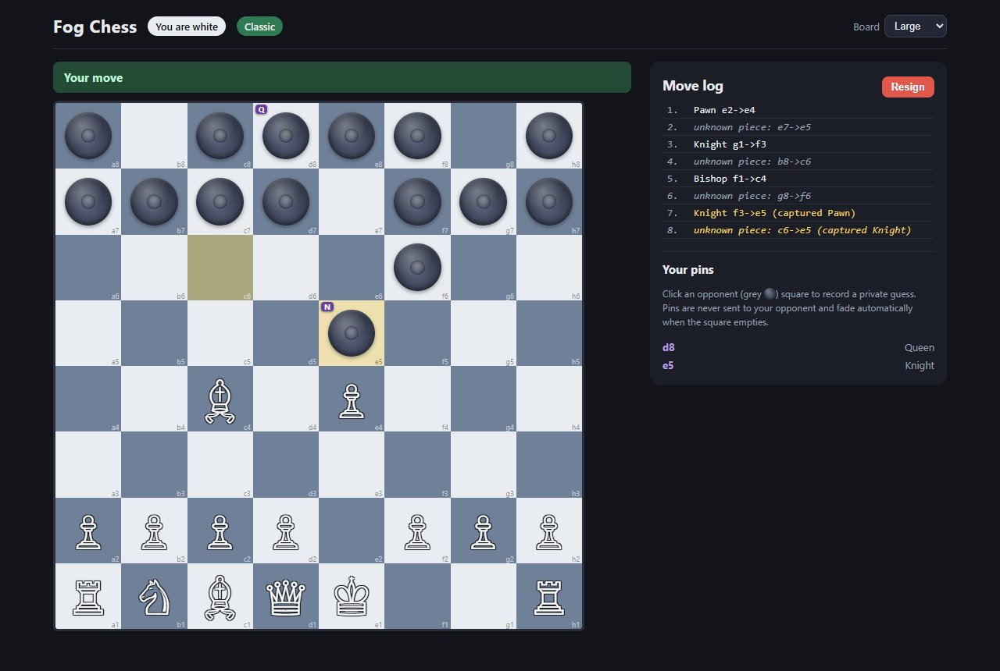
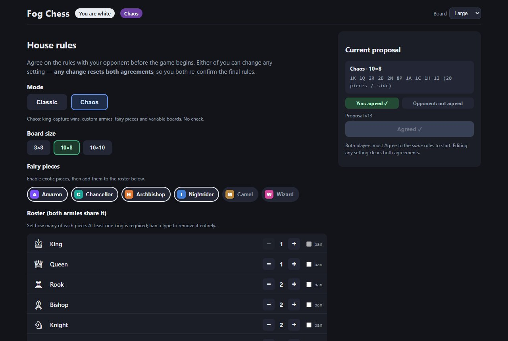
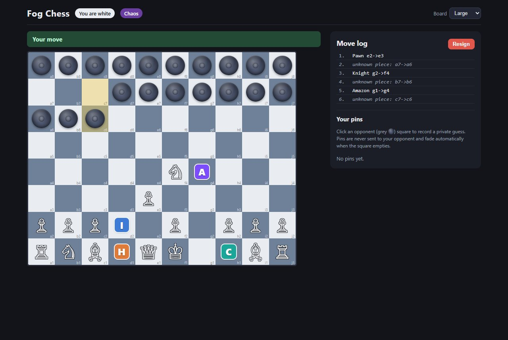

# Fog Chess

**Real-time, hidden-information chess for two players. You can see where your opponent's pieces are, but not what they are.**

Play online with a friend anywhere: create a match, send them the link (or let them scan the QR code), and play. It also still runs on your own computer for games on the same Wi-Fi.

> **Play online:** [fog-chess-game.pages.dev](https://fog-chess-game.pages.dev/)

Before the game, each player secretly arranges their own army. During the game, every enemy piece shows up as the same grey token. The server knows the full board and enforces the rules. Each player only ever receives a filtered view of it.



| Chaos mode: negotiating house rules | Chaos mode: 10×8 board with fairy pieces |
|---|---|
|  |  |

Fog Chess is close to the classic hidden-information variant **Kriegspiel**, with two twists:

1. **Secret setup.** Before the game, you arrange your own home ranks in any order.
2. **Private pins.** You can put private guess markers on your opponent's squares to keep track of what you think each hidden piece is. Your opponent never sees them.

---

## Status: work in progress

The game works end to end, online (Cloudflare Workers) and on a LAN (`npm start`). It is still a personal project, and a few things are unfinished.

**What works today**
- **Rooms.** Many matches can run at once. Each match has its own short code and invite link.
- Two players connect and negotiate house rules, then each arranges their pieces in secret and plays a full game with a result screen and a full reveal at the end.
- **Classic mode** uses the standard chess rules through `chess.js`: legal moves, check, checkmate, stalemate, draws (with the reason), en passant, promotion and castling. Castling is available when your king and rook start on their standard squares.
- **Chaos mode** has its own rules engine: custom armies, piece bans, 6 fairy pieces, 8×8 / 10×8 / 10×10 boards. You win by capturing the enemy king, and draws come from threefold repetition, the 50-move rule, or the player to move having no legal move.
- The fog filter is enforced on the server: an opponent's piece type is never sent to your browser while the game is running.
- **Reconnecting.** A reload or a dropped connection doesn't end the game. Your seat is held for 60 seconds while your opponent sees a countdown, and you come back to the same fogged board. Only after the 60 seconds does the player who stayed win by abandonment.
- Resign and rematch (both players go back to the house-rules screen and keep their colours). There is also a board-size setting and a sound on/off toggle, both saved in your browser.
- Automated tests (`npm test`) cover rooms, reconnecting, the abandonment timeout, the full reveal at the end of the game, the fog filter, bad messages, castling and the Chaos draw rules.

**Known limitations / what's next**
- **No spectators.** A room holds exactly two players; a third visitor is told the match is full.
- **No clocks.** A game only ends by the rules above, by resigning, or when a player leaves for more than 60 seconds.
- Private pins and a half-finished setup survive a reload of the **same tab** only (they live in `sessionStorage`).
- Games are kept in memory, with no database or accounts. Restarting the Node server (or a new Cloudflare deploy) ends the games that are running.

---

## Features

- **Real-time two-player play** over plain WebSockets.
- **House-rules negotiation.** Either player can propose the mode, board size, piece counts, bans and fairy pieces. Any change resets both agreements, and the game starts only when both players agree to the same proposal.
- **Easy joining.** While you wait for an opponent, the lobby shows the invite link, a **Copy link** button, a **QR code** and the 6-character match code. The QR code is drawn in your browser; no outside service is used.
- **Secret arrangement phase.** You place your pieces anywhere on your own home ranks, including pawns on the back rank. You can click to place or drag and drop. Classic mode has a "Standard setup" shortcut, Chaos mode has "Auto-fill", and both have **Randomize**, which shuffles your pieces with the pawns kept in front.
- **Fog of war.** Opponent pieces are drawn as a neutral hidden token, and their real type is never sent to you.
- **Capture reveals.** When a piece is captured, its type is revealed to both players ("Your pawn on d5 was captured."). The piece that made the capture stays hidden. This is configurable.
- **Fair check (Classic).** You are told when you are in check, and the checking piece's *square* is highlighted, but not its identity.
- **Private pins.** Click any occupied opponent square to record a guess (Pawn/Knight/…/King or free text). Pins stay in your browser, and a pin fades automatically when its square empties.
- **Anonymized move log**, laid out as numbered White/Black pairs. Your own moves are named in full (`Knight g1→f3`, `Castles kingside (e1→g1)`). Your opponent's moves show only the squares (`Hidden piece b8→c6, takes your Pawn`).
- **Full reveal** of both armies when the game ends, which is still there if you reload. The move log then names every piece on both sides. A result in plain words ("You won! Your opponent resigned.") and a **Copy position** button that copies the final position as FEN (Classic).
- **Reconnect within 60 seconds** after a reload or a network drop (see above).
- **Sounds** for moves, captures and the end of the game, made with the Web Audio API with no audio files. There is a mute toggle in the header.
- **Adjustable board size** (Small / Normal / Large / Huge), saved in `localStorage`. The board also shrinks to fit the window height, so it never needs scrolling on a laptop screen.
- **No build step, no database, no accounts:** `npm install && npm start`.

### Chaos mode

A "go wild" mode that both players must agree to. Instead of checkmate, **you win by capturing every enemy king**:

- **Custom piece counts:** multiple queens, multiple kings, extra knights, and so on (at least one king is required).
- **Piece bans:** a banned type is removed from both armies.
- **Fairy pieces** (6):

  | Piece | Letter | Moves like |
  |-------|:-----:|-----------|
  | **Amazon** | A | Queen **+** Knight |
  | **Chancellor** | C | Rook **+** Knight |
  | **Archbishop** | H | Bishop **+** Knight |
  | **Nightrider** | I | A knight that keeps riding in the same knight direction |
  | **Camel** | M | A (1,3) leaper |
  | **Wizard** | W | Camel **+** one-step diagonal |

- **Bigger boards:** 8×8, 10×8 or 10×10.
- There is no check, so there is no checkmate, and there is no castling.
- **Draws:** the player to move has no legal move; the same position (same player to move) appears for the third time; or 50 moves each go by without a capture or a pawn move.

Your own fairy pieces appear as coloured lettered badges. All of your opponent's pieces, standard or fairy, appear as the same hidden token.

---

## How it works: the server-side fog filter

The central design rule:

> **The rules engine uses standard, full-information rules. The fog is only a view filter applied when state is sent to each client. It never changes the rules.**

```
            full board (server memory only)
                         │
      ┌──────────────────┴──────────────────┐
      │ Classic: chess.js    Chaos: chaos.js│   legality, check, win/draw
      └──────────────────┬──────────────────┘
                         │
                  src/fog.js filterBoard(board, viewer)
                ┌────────┴────────┐
         White's view        Black's view
   own: {type,color}      own: {type,color}
   opp: {occupied:true}   opp: {occupied:true}
   empty: null            empty: null
```

- The **server** always holds the true board. Classic mode uses a `chess.js` instance, loaded from a FEN built from the two secret arrangements (`src/fen.js`). Chaos mode uses its own engine (`src/chaos.js`).
- Before **every** emit, `src/fog.js` turns the true board into a per-player copy. You get your own pieces in full, only `{occupied: true}` for opponent squares, and `null` for empty ones. Move-log entries are filtered the same way.
- `fog.js` works against a small "board source" interface (`get(square)`), so the same filter covers both modes and every board size without knowing any chaos rules.
- The full, unfiltered board is sent only **after the game has ended**: in the `gameOver` event, and in the `gameOver` field of the ended `state`, so a player who reloads still gets the reveal. The move log starts naming opponent pieces at that same moment.
- The client (`public/client.js`) has no code path that draws an opponent piece type from the live board. The information simply isn't there.

The events and payload shapes are specified in [`docs/CONTRACT.md`](docs/CONTRACT.md) and [`docs/CONTRACT-v2.md`](docs/CONTRACT-v2.md). Those documents were written for Socket.io; the event names and payloads are unchanged, but they now travel over a plain WebSocket at `/ws?room=CODE` as JSON text frames: `{ "t": event, "d": data }`, with an optional `id` that the server answers with `{ "ack": id, "d": ... }`. Messages over 16 KB, unknown events and malformed payloads are ignored or closed. On top of those documents:

- **Hello and seat tokens.** The first message on every connection is `hello` (it replaces the old Socket.io handshake). The first `assigned` event carries a random `token`. The browser keeps it (per room) and sends it back in `hello` (`{ token }`). A matching token resumes that seat (`assigned.resumed: true`). The server hands tokens out; a client can never choose its own.
- **Away seats.** When a socket drops, its seat is held for `RECONNECT_SECONDS` (default 60). The opponent's `state` has `opponentConnected: false` and `opponentAwayMs`, the time left. A third connection is rejected with `reason: "reconnecting"` while a seat is held.
- **Timeout.** Mid-game, the player who stayed wins with `result`/`reason` `"abandoned"`, and gets the usual `gameOver` with the full reveal. In the house-rules or setup phase, the player who stayed goes back to the lobby. When both players are gone, the room is freed.
- **After the game.** Someone who connects after a game has ended, when a seat is free or its owner is away, starts a fresh match instead of seeing the old end screen.
- **New `state` fields:** `lastMove`, `gameId`, `reconnectGraceMs`, `opponentAwayMs`, and `gameOver` when `phase` is `"ended"`.

---

## Rooms and invites

- Opening the site without a room shows a start screen: **Create a match**, or **Join with a code**.
- **Create a match** asks the server for a new room code (`POST /api/rooms`) and takes you to `/?room=CODE`. Codes are 6 characters long and skip letters and numbers that are easy to mix up (no `0`/`O`, `1`/`I`/`L`).
- The waiting screen shows the invite link (`<site>/?room=CODE`), a **Copy link** button, a QR code and the code itself. Your opponent opens the link, scans the code, or types the code on the start screen.
- The first two people in a room become **White** and **Black**. A third person sees "This match is full", with a button to create their own match.
- Your seat is remembered per room in your browser, so a reload or a dropped connection puts you back in your seat. **Rematch** keeps you in the same room.
- A room is freed once both players have left and the reconnect window has passed. Opening an old link after that simply starts a new, empty match with that code.

---

## Run locally

**Requirements:** [Node.js](https://nodejs.org/) 20 or newer, and a modern browser.

```bash
git clone https://github.com/naniiic137/fog-chess.git
cd fog-chess
npm install
npm start
```

The server prints its addresses:

```
Fog Chess running at:
  http://localhost:3000
  http://192.168.1.42:3000
```

- On the host, open `http://localhost:3000` and click **Create a match**. When you opened the page as `localhost`, the invite link and QR code use your LAN address, so a second device on the **same Wi-Fi** can open it.
- To try it alone, open the invite link in a second window. A private/incognito window or a different browser works too.
- The Node server runs many rooms at once, just like the online version.

You can also run the Cloudflare version on your computer with `npx wrangler dev` (it serves on `http://localhost:8787`, with a local Durable Object per room).

### Running the tests

```bash
npm test
```

This runs the `node:test` suites in `test/`. They start an in-process server with a short reconnect window and drive it with real WebSocket clients (the `ws` package) to check reconnecting mid-game (the fogged view is restored), the abandonment timeout, the full reveal after a game ends (including after a reload), taking over a seat from the same tab, and freeing a room when both players leave. Room tests cover room codes, two matches running side by side, rematch in the same room, a full room, invalid room codes, and junk or oversized messages (with a check that no payload leaks an enemy piece type). Rule tests cover castling and the Chaos draw rules.

### Changing the port

```bash
# macOS / Linux / Git Bash
PORT=4000 npm start

# Windows PowerShell
$env:PORT=4000; npm start

# Windows CMD
set PORT=4000 && npm start
```

The reconnect window can be changed the same way, for example `RECONNECT_SECONDS=120 npm start`.

---

## Deploy to Cloudflare

The online version runs on **Cloudflare Workers** with **Durable Objects**, and fits in the free plan. The Worker serves the files in `public/` and creates rooms; each room code gets its own Durable Object that holds that one match. Everything is set up in [`wrangler.jsonc`](wrangler.jsonc).

1. In the Cloudflare dashboard, go to **Workers & Pages → Create application**.
2. Choose **Continue with GitHub** and pick this repository.
3. Keep the project name **`fog-chess`** (it must match `name` in `wrangler.jsonc`).
4. Leave the build command empty and set the **deploy command** to `npx wrangler deploy`. The root directory is the repository root.
5. Click **Deploy**. Each new push to `main` deploys again.

The site is then live at `https://fog-chess.<your-subdomain>.workers.dev` (the link at the top of this README).

To check the setup without deploying, run `npx wrangler deploy --dry-run`.

---

## How to play

1. **Lobby.** Click **Create a match**, then share the invite link, QR code or match code on the waiting screen and wait for the second player to join.
2. **House rules.** Pick **Classic** or **Chaos**. For Chaos, also set the board size, piece counts, bans and fairy pieces. Both players press **Agree** on the same proposal.
3. **Setup (secret).** You only see your own home ranks. Click a tray piece to pick it up, then click home squares to place it (dragging works too). Click a placed piece to remove it, or use **Standard setup** / **Auto-fill** / **Randomize**. Press **Ready** once every piece is placed.
4. **Play.** Click one of your pieces to see its legal moves, then click a highlighted square. Opponent moves flash their from/to squares. If a pawn reaches the last rank, you choose what it promotes to.
5. **Pins.** Click any occupied opponent square to save a private guess.
6. **Disconnects.** If you reload or lose the connection, you have 60 seconds to come back. Just reopen the page in the same browser. Your opponent sees "Opponent disconnected, waiting 60 s" in the meantime.
7. **End.** On checkmate, king capture, stalemate, a draw, resignation or abandonment, both armies are revealed and the move log names every piece. **Rematch** (both players must accept) takes you back to the house-rules screen with the same colours. In Classic, **Copy position** copies the final position as FEN.

---

## Configuration

| Where | Option | Default | Effect |
|---|---|---|---|
| `Room` options (`src/room.js`) | `revealCapturedPieceType` | `true` | Reveal a captured piece's type to both players. Set it to `false` for a harder, fully blind game. |
| Environment | `PORT` | `3000` | TCP port the Node server listens on. |
| Environment | `RECONNECT_SECONDS` | `60` | Node server only: how long a disconnected player's seat is held before they lose the game (or their seat, before the game has started). The Cloudflare version always uses 60 seconds. |
| Browser | Board size | Large | Small / Normal / Large / Huge, saved in `localStorage`. The board also fits itself to the window height. On phones it simply fills the width. |
| Browser | Sound | On | Mute toggle in the header, saved in `localStorage`. |

---

## Project structure

```
fog-chess/
├── server.js            # Node adapter: Express static + ws, one Room per code, /api/rooms, /api/info
├── worker/index.js      # Cloudflare adapter: Worker (assets, /api/rooms, /ws) + Room Durable Object
├── wrangler.jsonc       # Cloudflare config (assets, Durable Object binding, migration)
├── package.json
├── test/                # npm test: node:test + ws clients (rooms, reconnect, abandonment, reveal, rules)
├── src/
│   ├── room.js          # One match room, transport-agnostic: hello/seats, events, timers, payload checks
│   ├── game.js          # Match state machine (lobby → config → setup → playing → ended), seats/tokens, draws
│   ├── fog.js           # The fog filter: the only module that handles hidden information
│   ├── fen.js           # Validates classic arrangements and builds the starting FEN for chess.js
│   └── chaos.js         # Chaos rules engine: fairy pieces, variable boards, king capture
├── public/              # Static frontend (no framework, no bundler)
│   ├── index.html       # Markup for every screen (start / lobby / house rules / setup / game / end) + modals
│   ├── style.css
│   ├── net.js           # Small WebSocket client: emit/on/acks, auto-reconnect, heartbeat
│   ├── client.js        # Rendering, setup, moves, pins, rooms, socket wiring
│   └── vendor/qrcode.js # qrcode-generator (MIT), draws the invite QR code in the browser
└── docs/
    ├── screenshots/
    ├── PLAN.md, PLAN-v2.md             # Implementation plans (v1 classic, v2 chaos mode)
    ├── CONTRACT.md, CONTRACT-v2.md     # Event contract (payload shapes; written for Socket.io)
    ├── fog-chess-build-prompt.md       # Original project brief
    └── transcripts/                    # Build and test logs, including the fog-leak audit
```

---

## Tech stack

- **Node.js**, **Express** (static hosting) and **ws** (WebSockets) for running locally
- **Cloudflare Workers** + **Durable Objects** for the online version (one object per room)
- **chess.js** for Classic-mode rules, with a hand-written engine for Chaos mode
- Plain **HTML / CSS / JavaScript** frontend with no framework and no build step

---

## Troubleshooting

**On your own network (`npm start`): the second device can't reach the page, or it stays on "Connecting…".**
This is almost always the host's firewall. (The online version has no such problem: just share the link.)
- **Windows:** the first time you run the server, allow Node.js in the Windows Defender Firewall prompt with **Private networks** checked. If you dismissed the prompt, go to *Windows Security → Firewall & network protection → Allow an app through firewall*.
- **macOS:** *System Settings → Network → Firewall*, then allow incoming connections for Node.
- Make sure both devices are on the **same** network (not a guest network and not cellular).

**`EADDRINUSE` (port already in use).** Start the server on another port, for example `PORT=4000 npm start`.

**"This match is full."** Two players are already in that room. Click **Create my own match**, or close one of the other tabs or devices and reload.

**A player disconnected mid-game.** Reopen the page in the same browser within 60 seconds and the game carries on. After that, the player who stayed wins by abandonment, and the next person to open the link starts a fresh match in that room.

**"A game is in progress and one player is reconnecting."** Both seats are taken, and one of them is being held for a player who dropped. Wait up to a minute and reload.

---

## Rules notes

- **Castling (Classic):** allowed when your king starts on e1/e8 and a rook starts on a1/h1 (a8/h8), which is exactly what **Standard setup** does. The normal rules apply after that: the king and that rook must not have moved, the squares between them must be empty, and the king may not castle out of, through or into check. Chaos mode has no castling.
- **Back-rank pawns** are allowed. They move one square at a time until they reach their 2nd rank.
- **Promotion** works as normal. In Chaos mode the choices come from the agreed roster. If no choice is sent, the pawn promotes to a queen (when a queen is available).
- **Draws (Chaos):** threefold repetition, 50 moves each without a capture or pawn move, or no legal move for the player to move.

## License

© 2026 Hamza Ben Ismail. All rights reserved.
